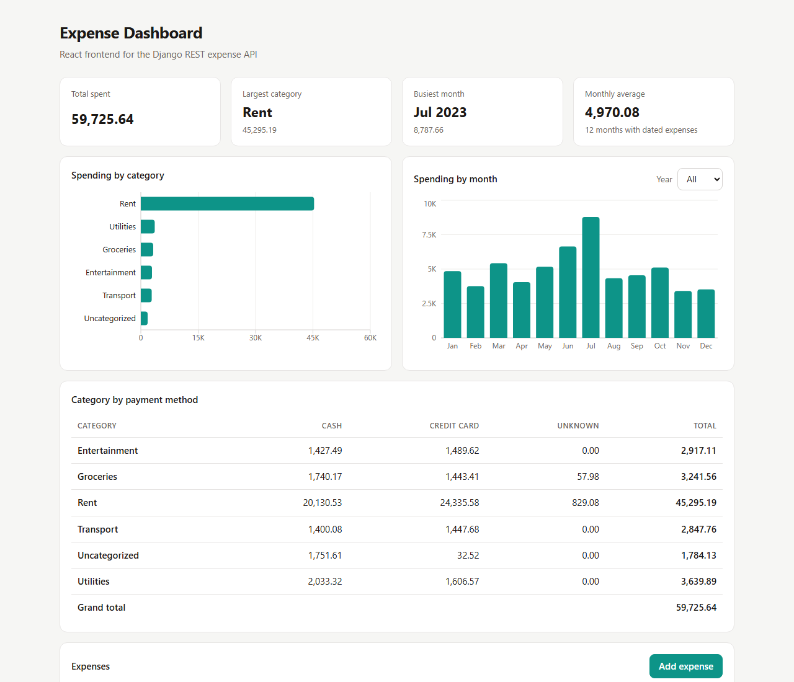

# Expense Analysis — Django REST API + React Dashboard


A full-stack expense tracker:

- **Backend:** a REST API built with Django and Django REST Framework. It imports expense records from a CSV file, validates them and returns reports as JSON.
- **Frontend:** a React + TypeScript dashboard that shows the reports as charts and lets you add, edit, filter and delete expenses.
- **CLI:** a small command-line report that works on the CSV file directly.



## Features

### Backend

- CSV import command with row-level validation. A file with any bad row is rejected as a whole, and every bad line is reported with its line number. Running the import again updates existing rows instead of creating duplicates.
- CRUD API for expenses with filtering and pagination
- Report endpoints that use database aggregation (`SUM`, `GROUP BY`, month truncation), not Python loops
- `Decimal` amounts, so totals have no floating-point rounding errors
- Django admin for browsing and editing expenses
- Secret key, debug mode and allowed hosts read from environment variables

### Frontend

- Summary cards, spending-by-category and spending-by-month charts with hover tooltips, and a category × payment-method table
- Expenses table with category and payment filters and server-side pagination
- Add and edit form with client-side validation; field errors from the API are shown next to each field
- Typed API client that turns network failures and Django REST Framework errors into clear messages
- Light and dark mode, and a layout that works on small screens

## Tech stack

- **Backend:** Python, Django 5.1, Django REST Framework 3.15, SQLite
- **Frontend:** React 18, TypeScript, Vite, Recharts
- **Testing:** Django test runner, unittest, Vitest, React Testing Library
- **CI:** GitHub Actions

## Requirements

- Python 3.10 or newer (CI uses 3.12)
- Node.js 18 or newer (CI uses 20)

## Run the backend

```bash
git clone https://github.com/Kritimandal/task-expense-analysis.git
cd task-expense-analysis
python -m venv venv
source venv/bin/activate        # Windows: venv\Scripts\activate
pip install -r requirements.txt

cd API
python manage.py migrate
python manage.py import_expenses ../expenses.csv
python manage.py runserver
```

The API runs at http://127.0.0.1:8000. Opening an endpoint in a browser shows Django REST Framework's browsable API.

To use the Django admin at http://127.0.0.1:8000/admin/, create a user first:

```bash
python manage.py createsuperuser
```

## Run the frontend

In a second terminal, with the backend running:

```bash
cd frontend
npm install
npm run dev
```

Open http://localhost:5173. During development, Vite forwards requests from `/api/*` to the Django server, so the browser sees one address and no CORS setup is needed.

To build the frontend for a separate API address, set `VITE_API_URL` (for example `VITE_API_URL=https://api.example.com npm run build`). The API would then need CORS headers for the frontend's domain, which this project does not include yet.

## Configuration

| Variable | Default | Use |
|---|---|---|
| `DJANGO_SECRET_KEY` | a development-only value | Set a real secret in production |
| `DJANGO_DEBUG` | `true` | Set to `false` in production |
| `DJANGO_ALLOWED_HOSTS` | `localhost,127.0.0.1` | Comma-separated host names |

## API endpoints

| Method | URL | Description |
|---|---|---|
| GET | `/expenses/` | List expenses. Filters: `?expense_type=Rent&payment_method=Cash`. 50 per page. |
| POST | `/expenses/` | Create an expense |
| GET, PUT, PATCH, DELETE | `/expenses/<id>/` | Read, update or delete one expense |
| GET | `/expense_by_type/` | Total amount for each expense type |
| GET | `/monthly_expenses/` | Total for each month. Optional `?year=2023` |
| GET | `/detailed_breakdown/` | Each expense type split by payment method, plus a grand total |

### Example: `GET /detailed_breakdown/` (shortened to one row)

```json
{
  "expense_types": [
    {"expense_type": "Rent", "Cash": 20130.53, "Credit Card": 24335.58, "Unknown": 829.08, "total": 45295.19}
  ],
  "grand_total": 59725.64
}
```

### Example: validation error from `POST /expenses/` (HTTP 400)

```json
{
  "expense_type": ["\"Food\" is not a valid choice."],
  "amount": ["Ensure this value is greater than or equal to 0."]
}
```

## Data rules

The sample `expenses.csv` has 300 rows, and some of them have missing values. The import handles them like this:

| Missing value | Stored as |
|---|---|
| `amount` | `0.00` |
| `expense_type` | `Uncategorized` |
| `payment_method` | `Unknown` |
| `expense_date` | empty; the row counts in the type totals but not in the monthly totals |

Values that are present but wrong (for example `amount=abc`, `expense_type=Food` or an invalid date) are errors, and nothing is imported until they are fixed.

## Command-line report

```bash
python report.py expenses.csv
```

This prints the total, the totals by type, by payment method and by month, the day with the highest spending, and a type × payment-method table.

## Tests

51 automated tests run on every push with GitHub Actions:

| Part | Tests | Tool |
|---|---|---|
| API, CSV import and reports | 19 | Django test runner |
| CLI report | 7 | unittest |
| React components and API client | 25 | Vitest + React Testing Library |

Run them from the project root:

```bash
python -m unittest test_report
cd API && python manage.py test && cd ..
cd frontend && npm test && cd ..
```

## Project structure

```
├── expenses.csv               sample data (300 rows)
├── requirements.txt           Python packages
├── report.py                  command-line report
├── test_report.py             CLI report tests
├── docs/dashboard.png         screenshot
├── .github/workflows/         GitHub Actions
├── frontend/
│   └── src/
│       ├── api.ts             typed API client and error handling
│       ├── App.tsx            dashboard layout
│       ├── components/        charts, tables, expense form
│       └── test/              Vitest tests
└── API/
    ├── config/                settings and root URLs
    └── expenses/
        ├── models.py          Expense model with choices and indexes
        ├── csv_import.py      CSV parsing and validation
        ├── management/commands/import_expenses.py
        ├── reports.py         aggregation queries
        ├── views.py           API views
        └── tests.py           API, import and report tests
```
